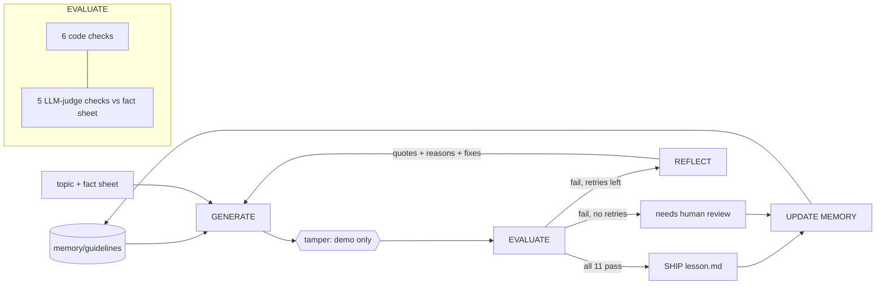

# Design: why it is built this way

## 1. The problem, restated

The job is not "write a good lesson". It is **own a system that decides, by itself, whether content is good enough to ship**. That means three things must be true:

1. The *bar* is written down and strict (hard pass/fail, no partial credit).
2. The thing that checks the bar is *independent* of the thing that writes the content.
3. When the bar is missed, the system either *fixes it with specific feedback* or *stops and escalates*. It never ships a failing lesson.

## 2. Architecture

| Component | File | Job |
|---|---|---|
| State machine | `graph.py` | LangGraph. Owns retry/stop decisions in plain Python. |
| Writer | `generator.py`, `prompts/generator.md` | Writes the lesson, or rewrites it from structured feedback; returns a change list. |
| Evaluator | `evaluator.py`, `deterministic.py`, `prompts/evaluator.md` | Code checks + LLM judge. Never edits the lesson. |
| Rubric | `rubric.yaml` | The bar. Human-owned. |
| Ground truth | `knowledge/rag_facts.yaml` | What "accurate" means. Human-reviewed. |
| Memory | `memory.py`, `evolve.py` | Guidelines, run history, human feedback, rubric proposals. |

### Why LangGraph (and not one long prompt, or n8n)
The loop has real control flow (conditional retry, a hard stop, a finalize path) and shared state (draft, history, feedback). A state machine makes that explicit and testable: `route()` is 4 lines of Python, so the loop *cannot* run forever (`1 + max_retries` attempts, retries clamped to 2). n8n would also work, but I wanted unit tests and typed state.

## 3. The evaluator (the most important part)

### 3.1 Two layers, on purpose
| Layer | Good at | Bad at |
|---|---|---|
| **Code** (6 checks) | reading level, required sections, length, idioms, defined jargon, known false claims. Repeatable, free, cannot be charmed by fluent text. | anything needing understanding |
| **LLM judge** (5 checks) | accuracy vs. facts, coverage, quality of the example, flow, audience fit | consistency, leniency, being fooled by confident prose |

Anything that *can* be measured with code is measured with code. The judge is only used where meaning is needed. A lenient judge cannot rescue a lesson that code rejects (there is a test for this).

### 3.2 Hard pass/fail, built to fail closed
- Every check is binary and written as a precise `pass_if` sentence. No 1-10 scores, so there is nothing to negotiate.
- The lesson ships only if **all 11 pass**.
- The judge is told: if unsure, FAIL. The code treats anything that is not a clear `PASS` as FAIL, a missing verdict as FAIL, and unreadable output as FAIL for all judge checks.
- A FAIL must quote the offending words. The code checks that the quote really appears in the lesson (`evidence_verified`), which makes hallucinated criticism visible.
- The judge sees only the lesson and the facts, not earlier attempts, so it does not anchor on "this is better than last time".

### 3.3 "Accurate and grounded" needs something to be grounded *in*
A judge with no reference only checks whether text *sounds* right. So the judge gets a short, human-reviewed **fact sheet** (`rag_facts.yaml`), plus a list of the typical mistakes (RAG ≠ fine-tuning, RAG does not remove hallucinations, only the top chunks go to the LLM, wrong origin, invented statistics). Regex tripwires catch the most common ones for free; the judge catches the subtle ones (`--tamper subtle_fact` is a sentence no regex catches).
**Limit:** the evaluator can only be as accurate as the fact sheet. It cannot detect an error the fact sheet does not cover. That is why the fact sheet is a human-owned input and has a `sources` field.

### 3.4 Writer and judge are separate
Different prompts, no shared memory of the lesson, and `EVALUATOR_MODEL` can be a different (stronger) model than `GENERATOR_MODEL`. Models tend to rate their own style higher, so a different judge reduces that.

### 3.5 Both layers always run
I run code and judge on every attempt even if code already failed. It costs one extra judge call, but one rejection then lists *every* problem, so the writer fixes everything in one retry instead of discovering new failures each round. With only two retries available, that matters more than the cost.

## 4. Regeneration

- The writer receives: the previous draft, **each failed check with the reason, the quoted evidence and a concrete fix**, and the instruction to keep what passed.
- It must return a change list (`===CHANGES===`). The log stores that list and a line-diff count, so the rejection log answers "what did you change on retry?" with the writer's own account plus a measured diff.
- **Termination:** at most `1 + max_retries` attempts (max 3). If the last attempt still fails, the best attempt (fewest failed checks) is saved as `lesson.DRAFT_needs_human_review.md` and the run exits with a non-zero status. A failing lesson is never saved as `lesson.md`.

## 5. Memory and self-evolution

| Memory | Where | Used for |
|---|---|---|
| Learned guidelines | `guidelines.json` (versioned) | injected into every writer prompt |
| Run history | `run_history.jsonl` | what failed first time, over time |
| Human feedback | `human_feedback.jsonl` | learned immediately |
| Rubric proposals | `rubric_proposals.md` | for a human to read |

**What evolves by itself:** writer guidelines. If a check fails on the *first* attempt in `EVOLVE_THRESHOLD` real runs (default 2), the system asks an LLM to write one short, topic-independent, testable guideline for it (max 40 words). If that check keeps failing *after* a guideline exists, the guideline is rewritten rather than duplicated. Guidelines are plain text, versioned, capped (15) and easy to delete.

**What does not evolve by itself:** the rubric. A system that can edit its own bar can "improve" by lowering it. When a check keeps failing despite a guideline, the system only writes a *proposal* ("this check fails 60% of the time, maybe it is unclear or too strict") for a human.

**Learning only from real failures:** runs with a deliberate error (`--tamper`) are flagged and excluded, otherwise the demo would teach the writer lessons from mistakes it never made.

Guidelines are written to be topic-independent ("define each technical word the first time you use it"), so what the system learns about RAG lessons helps with the next topic.

## 6. Trade-offs I chose

| Decision | Alternative | Why |
|---|---|---|
| Transparent rubric given to the writer | Hidden rubric | The writer should aim at the real target. The risk of "teaching to the test" is covered by an independent judge, code checks on measurable properties, and the fact sheet. |
| 11 narrow checks | 3-4 broad checks | Narrow checks give precise feedback ("jargon: 'embedding' not explained") and make retries effective. |
| Heuristic `jargon_defined` | LLM-only check | Cheap and consistent as a first line; `audience_fit` (LLM) then judges whether the explanation is actually understandable. |
| Plain-file memory | Vector DB / SQL | Tiny scale; humans can read, diff and edit it, which matters for trust. |
| Max 2 retries | Loop until pass | The brief asks for guaranteed termination; escalation to a human is a feature. |

## 7. Failure modes and what handles them

| Risk | Mitigation |
|---|---|
| Judge too lenient | Code layer cannot be talked around; fail-closed parsing; evidence must be quotable. Next step: a human-labelled gold set to measure judge agreement. |
| Judge too strict, loop never passes | Hard cap on retries; escalation to human; proposals when a check fails > 50% |
| Writer "fixes" one thing, breaks another | Whole rubric re-run on every attempt; "keep what passed" instruction; log shows diff size |
| Fact sheet is wrong or incomplete | Human-reviewed, has `sources`; documented as the main limit |
| Memory fills with noise | Cap on guidelines; synthetic runs excluded; threshold before learning; versioned |
| Judge returns non-JSON | One retry, then fail closed |

## 8. What I tested, and what I did not

**Tested (30 automated tests, offline):** the graph loop and its termination for 1 and 2 retries; a failing lesson is never shipped; each deliberate error is rejected and then repaired; tampered runs are not learned from; repeated failures create guidelines and they reach the next writer prompt; human feedback is learned immediately; the rubric file is never modified; the judge fails closed on garbage and on missing verdicts; a lenient judge cannot override the code; the Anthropic/OpenAI adapters build the right requests (with fake clients).

**Not tested here:** the system against a live model. The offline tests use a mock writer/judge, so they prove the *plumbing*, not the *quality* of real model output or real judge accuracy. The first real run is the real test; the thresholds in `rubric.yaml` (for example average sentence length 14) were tuned on one hand-written lesson and may need adjusting after seeing real output.

## 9. What I would build next

1. **Judge calibration:** 20-30 human-labelled lessons (good, subtly wrong, jargon-heavy) and a report of judge-vs-human agreement per check.
2. **Teach-back test:** a second model with no RAG knowledge reads the lesson and must answer the "Check yourself" questions. If it can't, the lesson did not teach.
3. **Judge ensemble:** two judges from different model families; a check passes only if both pass.
4. **Multi-topic evaluation set:** run the same loop on 5-10 topics to see if learned guidelines transfer.
5. **Cost and latency tracking** per attempt.
